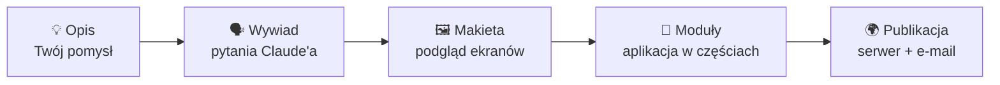

<div align="center">

# 🧩 stepkit

**Zbuduj własną aplikację www z Claude, krok po kroku, bez programowania.**

[](LICENSE)


[Instalacja](#-instalacja) · [Jak to działa](#-jak-to-działa) · [Co dostajesz](#-co-dostajesz) · [Pytania](#-częste-pytania)

</div>

---

Masz pomysł na aplikację albo usługę na abonament (SaaS), ale nie programujesz? Pewnie już próbowałeś z AI i znasz
ten scenariusz: jedna ogromna rozmowa, tokeny znikają w oczach, a po godzinie Claude zapomina, co ustaliliście na
początku.

**stepkit to dodatek (plugin) do Claude Code, który robi to inaczej:**

- 🪜 **dzieli aplikację na małe części** i prowadzi przez każdą osobno,
- 💬 **pracuje w krótkich rozmowach**, więc zużywa dużo mniej tokenów,
- 📝 **zapisuje wszystko w plikach**, więc każda nowa rozmowa wie, na czym skończyliście,
- 👀 **najpierw pokazuje makietę**, potem buduje, więc widzisz aplikację, zanim powstanie kod,
- ✅ **sam testuje** swoją pracę w przeglądarce, zanim poprosi o to Ciebie.

Na końcu Twoja aplikacja działa w internecie, pod Twoim adresem.

> 🌐 **Dla jakich projektów?** stepkit buduje aplikacje, które działają **w internecie, pod własnym adresem www**
> (np. `twojafirma.pl`) i otwiera się je w przeglądarce, także na telefonie: systemy dla firm, panele klienta, usługi
> na abonament, rezerwacje, zamówienia. Nie zbudujesz z nim aplikacji do pobrania ze sklepu (App Store, Google Play)
> ani programu instalowanego na komputerze.

## 🚀 Instalacja

W Claude Code (w terminalu albo w VS Code) wpisz po kolei:

```
/plugin marketplace add Maciej86/stepkit
/plugin install stepkit@stepkit
/plugin install superpowers@claude-plugins-official
/plugin install playwright@claude-plugins-official
/plugin install frontend-design@claude-plugins-official
```

Zamknij i otwórz Claude Code ponownie. Gotowe.

> **Potrzebujesz:** komputera z Windows 10/11 albo macOS, Claude Code i płatnego planu Claude.
> Resztę programów stepkit pomoże Ci zainstalować.

## 🎯 Jak zacząć

1. Utwórz **pusty folder** na aplikację i otwórz go w Claude Code.
2. Wpisz **`/stepkit:start`** i opisz swój pomysł własnymi słowami.
3. Po każdej skończonej części: **nowa rozmowa → `/stepkit:dalej`**.

To wszystko. Dwie komendy na cały projekt.

## 🔄 Jak to działa



**`/stepkit:start`** zakłada projekt, wypytuje o pomysł (kto się loguje, jakie są role, czy są e-maile, czy
potrzebna jest historia zmian…), pokazuje makietę całej aplikacji i rozpisuje ją na moduły.

**`/stepkit:dalej`** prowadzi przez jeden moduł, zawsze tymi samymi etapami:

| Etap | Co się dzieje | Co robisz Ty |
|---|---|---|
| 🖼️ **Makieta** | Claude projektuje ekrany modułu, pytania zbiera w panelu nad makietą | oglądasz w przeglądarce |
| ❓ **Pytania** | doprecyzowanie szczegółów | odpowiadasz |
| 📋 **Spec** | dokładny opis, co moduł robi | akceptujesz |
| 🗺️ **Plan** | lista kroków, każdy z testem | akceptujesz |
| ⚙️ **Implementacja** | Claude pisze kod: najpierw test, potem kod | — |
| 🧪 **Testy** | Claude klika w aplikacji, potem lista do sprawdzenia dla Ciebie | potwierdzasz „działa” |
| 🏁 **Zamknięcie** | zapis na GitHubie, makieta modułu oznaczona jako wykonana | — |

Kolejność modułów proponuje stepkit: najpierw **Wygląd** (porównujesz 3 warianty na swoich ekranach i dopracowujesz
wybrany, choćby przez kilka rozmów), potem logowanie, kolejne części, na końcu publikacja. Ustalony wygląd trafia do
„księgi wyglądu” (`docs/DESIGN.md`), więc każda kolejna część wygląda spójnie z resztą.
Nie da się przeskoczyć do następnego modułu, zanim obecny nie będzie gotowy (chyba że świadomie go wstrzymasz).

Postęp całego projektu widzisz w każdej chwili na stronie **Postęp** w makietach.

## 📦 Co dostajesz

Aplikację zbudowaną krok po kroku według sprawdzonego procesu. W środku znajdziesz:

- 🌐 **trzy części** (wybierasz, które są potrzebne): strona dla odwiedzających, konto użytkownika, panel
  administracyjny,
- 🔐 **logowanie i role** (np. administrator, menadżer, pracownik), każda rola widzi tylko swoje,
- 🗄️ **baza danych MySQL** z poprawnymi powiązaniami, archiwum zamiast twardego usuwania i (jeśli chcesz) historią
  „kto, co i kiedy zmienił”,
- ✉️ **e-maile**: lokalnie podgląd w Mailpit, w internecie wysyłka przez Mailgun,
- 🧪 **testy**: automatyczne testy kodu, formularzy i całych ścieżek w przeglądarce, uruchamiane jedną komendą,
- 🌍 **teksty w osobnych plikach**, więc kolejna wersja językowa to tłumaczenie, a nie przepisywanie,
- 🚀 **publikacja** na serwerze VPS (domyślnie OVH) z certyfikatem HTTPS i kopiami zapasowymi bazy.

> ⚖️ **Uczciwie o jakości.** stepkit sam w sobie nie gwarantuje najlepszego kodu: pisze go Claude, a Claude też
> popełnia błędy. stepkit pilnuje za to **procesu**: makieta przed kodem, spec i plan przed implementacją, test przed
> każdym kawałkiem kodu, przegląd kodu i sprawdzenie w przeglądarce na końcu każdej części. Taki proces daje wyraźnie
> lepszy, łatwiejszy do poprawiania kod niż aplikacja wygenerowana jednym promptem w jednej długiej rozmowie.
> Przed udostępnieniem aplikacji klientom, zwłaszcza gdy przechowuje dane osobowe albo płatności, warto pokazać ją
> doświadczonemu programiście.

<details>
<summary><b>Technologie (dla ciekawych)</b></summary>

| Część | Technologia |
|---|---|
| Wygląd | React, Vite, TypeScript, Mantine, ikony Lucide |
| Serwer | Node.js, Express, TypeScript |
| Baza | MySQL 8 w Dockerze |
| Walidacja | zod (te same reguły w przeglądarce i na serwerze) |
| Teksty | i18next |
| Testy | Vitest, Playwright |
| Serwer produkcyjny | Docker Compose, Caddy (HTTPS) |

Wszystko w jednym repozytorium, wszystko darmowe i open source.

</details>

## 🧰 Po co te programy?

Przy pierwszym uruchomieniu stepkit poprosi o instalację kilku darmowych programów. To głównie **narzędzia pracy
Claude'a**: instalujesz je raz i nie musisz się ich uczyć, a praca jest dzięki nim szybsza i stabilniejsza.

| Program | Po co |
|---|---|
| [**Node.js**](https://nodejs.org) | silnik aplikacji; Claude sam ją uruchamia i testuje, zamiast zgadywać |
| [**Docker Desktop**](https://www.docker.com/products/docker-desktop) | „pudełko” z bazą danych, działa tak samo na Twoim komputerze i na serwerze |
| [**Git**](https://git-scm.com/downloads) i [**GitHub**](https://github.com/signup) | punkty zapisu jak w grze: po każdej działającej części powstaje zapis, do którego zawsze wrócisz |
| **superpowers** | sprawdzone sposoby pracy dla Claude'a: specyfikacja, plan, przegląd kodu |
| **Playwright** | Claude sam klika w Twojej aplikacji i sprawdza, czy działa |
| **frontend-design** | wiedza projektanta: makiety i aplikacja wyglądają jak dopracowany produkt, nie jak szablon |

## 🔒 Bezpieczeństwo

- Hasła i klucze trzymane są w pliku `.env`, który **nigdy nie trafia na GitHub**.
- Claude **nie prosi o hasła w rozmowie**. Komendy, które ich wymagają, wpisujesz sam w swoim terminalu.
- Na zrzutach ekranu (np. z panelu Mailgun) zamazujesz klucze, a stepkit przypomina o tym przy każdym kroku.
- Hasła na serwerze są generowane na serwerze i nigdzie się nie wyświetlają.
- Repozytorium Twojej aplikacji na GitHubie jest **prywatne**.

## ❔ Częste pytania

<details>
<summary><b>Dlaczego po każdej części mam otwierać nową rozmowę?</b></summary>

Każda wiadomość kosztuje tym więcej tokenów, im dłuższa jest cała rozmowa, a w bardzo długiej rozmowie AI zaczyna
gubić wcześniejsze ustalenia. stepkit zapisuje stan w pliku `docs/STATUS.md`, więc nowa rozmowa czyta krótki plik
zamiast całej historii. Taniej i dokładniej.
</details>

<details>
<summary><b>Czy muszę umieć programować albo znać Linuksa?</b></summary>

Nie. Wystarczy, że potrafisz opisać, co aplikacja ma robić, i odpowiadać na pytania. Wszystko działa na zwykłym
Windowsie i macOS.
</details>

<details>
<summary><b>Co, jeśli przerwę pracę w połowie?</b></summary>

Nic się nie stanie. Wpisz `/stepkit:dalej` w nowej rozmowie (nawet po tygodniu), a Claude wróci dokładnie do miejsca,
w którym skończyliście.
</details>

<details>
<summary><b>Ile to kosztuje?</b></summary>

stepkit jest darmowy (licencja MIT). Płacisz tylko za swój plan Claude, a na końcu, jeśli publikujesz aplikację, za
serwer (VPS) i domenę.
</details>

<details>
<summary><b>Czy mogę użyć innego serwera niż OVH?</b></summary>

Tak. OVH jest domyślną propozycją z instrukcją krok po kroku, ale przy publikacji możesz wybrać inny serwer VPS.
</details>

## 🛠️ Stan projektu

stepkit jest we **wczesnej wersji (0.1)**. Działa, ale może mieć niedoskonałości. Jeśli coś nie zadziała albo masz
pomysł na ulepszenie, [zgłoś to w Issues](https://github.com/Maciej86/stepkit/issues).

## 📄 Licencja

[MIT](LICENSE): używaj, zmieniaj i udostępniaj dalej za darmo.
