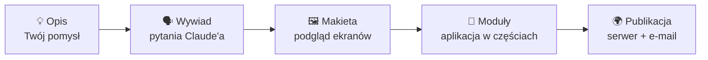

<div align="center">

# 🧩 stepkit

**Zbuduj własną aplikację www z Claude, krok po kroku, bez programowania.**

[](LICENSE)


**[🌐 Strona stepkit z dokładnym opisem](https://maciej86.github.io/stepkit/)**

[Instalacja](#-instalacja) · [Jak to działa](#-jak-to-działa) · [Co dostajesz](#-co-dostajesz) · [Pytania](#-częste-pytania)

</div>

---

Masz pomysł na aplikację albo usługę na abonament (SaaS), ale nie programujesz? Pewnie już próbowałeś z AI i znasz
ten scenariusz: jedna ogromna rozmowa, tokeny znikają w oczach, a po godzinie Claude zapomina, co ustaliliście na
początku.

**stepkit to dodatek (plugin) do Claude Code, który robi to inaczej:**

- 🪜 **dzieli aplikację na małe części** i prowadzi przez każdą osobno,
- 💬 **pracuje w krótkich rozmowach**, więc zużywa dużo mniej tokenów,
- 📝 **zapisuje wszystko w plikach**, więc każda nowa rozmowa wie, na czym skończyliście,
- 👀 **najpierw pokazuje makietę**, potem buduje, więc widzisz aplikację, zanim powstanie kod,
- ✅ **sam testuje** swoją pracę w przeglądarce, zanim poprosi o to Ciebie.

Na końcu Twoja aplikacja działa w internecie, pod Twoim adresem.

> 🌐 **Dla jakich projektów?** stepkit buduje aplikacje, które działają **w internecie, pod własnym adresem www**
> (np. `twojafirma.pl`) i otwiera się je w przeglądarce, także na telefonie: systemy dla firm, panele klienta, usługi
> na abonament, rezerwacje, zamówienia. Nie zbudujesz z nim aplikacji do pobrania ze sklepu (App Store, Google Play)
> ani programu instalowanego na komputerze.

## 🚀 Instalacja

### Claude Code w VS Code

1. Zainstaluj [VS Code](https://code.visualstudio.com) i uruchom go.
2. Utwórz pusty folder na aplikację **poza OneDrive** (np. `C:\projekty\moja-aplikacja`; OneDrive spowalnia
   i blokuje pliki projektu) i otwórz go w VS Code: **File → Open Folder**.
3. Otwórz terminal: **Terminal → New Terminal** (otworzy się na dole, od razu w tym folderze).
4. Zainstaluj Claude Code: wklej do terminala polecenie dla swojego systemu i naciśnij Enter.

   **Windows** (dwa polecenia, po kolei; drugie dopisuje Claude Code do listy programów, które widzi terminal):
   ```
   irm https://claude.ai/install.ps1 | iex
   ```
   ```
   $p = [Environment]::GetEnvironmentVariable('Path', 'User'); if ($p -notlike "*\.local\bin*") { [Environment]::SetEnvironmentVariable('Path', "$p;$env:USERPROFILE\.local\bin", 'User') }
   ```
   **macOS:**
   ```
   curl -fsSL https://claude.ai/install.sh | bash
   ```
5. **Zamknij całe VS Code i otwórz je ponownie** (z tym samym folderem), potem **Terminal → New Terminal**. Dopiero
   po ponownym uruchomieniu terminal „widzi” zainstalowany program.
6. Wpisz `claude` i naciśnij Enter. Za pierwszym razem otworzy się przeglądarka: zaloguj się na swoje konto Claude
   (potrzebny płatny plan, np. Pro albo Max). Od tej pory Claude Code uruchamiasz w terminalu VS Code poleceniem
   `claude` i tu wpisujesz wszystkie komendy z tej strony.

> 💡 Jest też oficjalna wtyczka [**Claude Code for VS Code**](https://marketplace.visualstudio.com/items?itemName=anthropic.claude-code)
> od **Anthropic** (niebieski znaczek weryfikacji) z panelem graficznym. Nie wszystkie komendy działają w niej tak samo jak w terminalu, więc do stepkit polecamy terminal.
> Uważaj na podobne, nieoficjalne wtyczki z tą samą ikoną.

### stepkit

W Claude Code (w terminalu VS Code) wpisz po kolei:

```
/plugin marketplace add Maciej86/stepkit
/plugin install stepkit@stepkit
/plugin install superpowers@claude-plugins-official
/plugin install playwright@claude-plugins-official
/plugin install frontend-design@claude-plugins-official
```

Zamknij Claude Code (wpisz `/exit`) i uruchom go ponownie (`claude`). Gotowe.

Przy pierwszym `/stepkit:start` Claude sprawdzi komputer i przeprowadzi Cię przez instalację Node.js, Git i Docker
Desktop, po jednym programie (przy Dockerze może być potrzebny restart komputera).

> **Potrzebujesz:** komputera z Windows 10/11 albo macOS, płatnego planu Claude i **edytora kodu z wbudowanym
> terminalem**. Polecamy darmowy [**VS Code**](https://code.visualstudio.com).
> Resztę programów stepkit pomoże Ci zainstalować.

> 💻 **Minimum, którego wymaga stepkit.** Nie musisz programować, ale raz na jakiś czas wpiszesz w terminalu
> polecenie, które poda Ci Claude, np. przy zakładaniu konta administratora. Hasła wpisuje się tylko tam, nigdy
> w rozmowie. W VS Code to proste: gdy masz otwarty folder projektu, menu **Terminal → New Terminal** otwiera
> terminal od razu w tym folderze. Wklejasz polecenie, naciskasz Enter i odpowiadasz na pytania. Czasem wkleisz też
> hasło do pliku `.env`: klikasz go w panelu plików po lewej, wklejasz i zapisujesz Ctrl+S.

## 🎯 Jak zacząć

1. Otwórz **pusty folder** na aplikację w VS Code i uruchom w nim Claude Code (`claude` w terminalu, jak wyżej
   w „Claude Code w VS Code”).
2. Wpisz **`/stepkit:start`** i opisz swój pomysł własnymi słowami.
3. Po każdej skończonej części: **nowa rozmowa (`/clear`) → `/stepkit:dalej`**.
4. Gdy wpadniesz na pomysł albo coś nie działa: **`/stepkit:zglos`**.

To wszystko. Trzy polecenia na cały projekt:

| Polecenie | Kiedy | Co robi |
|---|---|---|
| 🌱 **`/stepkit:start`** | raz, na początku | sprawdza komputer, wypytuje o pomysł, pokazuje makietę całej aplikacji i dzieli ją na moduły |
| ▶️ **`/stepkit:dalej`** | za każdym razem, gdy siadasz do pracy | prowadzi przez kolejny moduł albo wraca dokładnie tam, gdzie skończyliście |
| 💬 **`/stepkit:zglos`** | gdy masz pomysł, chcesz coś zmienić albo coś nie działa | rozpoznaje, czy to nowy moduł, zmiana w gotowym module, czy błąd, dopytuje i zapisuje albo od razu poprawia |

## 🔄 Jak to działa



**`/stepkit:start`** zakłada projekt, wypytuje o pomysł (kto się loguje, jakie są role, czy są e-maile, czy
potrzebna jest historia zmian…), pokazuje makietę całej aplikacji i rozpisuje ją na moduły.

**`/stepkit:dalej`** prowadzi przez jeden moduł, zawsze tymi samymi etapami:

| Etap | Co się dzieje | Co robisz Ty |
|---|---|---|
| 🖼️ **Makieta** | Claude projektuje ekrany modułu, pytania zbiera w panelu nad makietą | oglądasz w przeglądarce |
| ❓ **Pytania** | doprecyzowanie szczegółów | odpowiadasz |
| 📋 **Spec** | dokładny opis, co moduł robi | akceptujesz |
| 🗺️ **Plan** | lista kroków, każdy z testem | akceptujesz |
| ⚙️ **Implementacja** | Claude pisze kod: najpierw test, potem kod | — |
| 🧪 **Testy** | Claude klika w aplikacji, potem lista do sprawdzenia dla Ciebie | potwierdzasz „działa” |
| 🏁 **Zamknięcie** | zapis na GitHubie, makieta modułu oznaczona jako wykonana | — |

**`/stepkit:zglos`** przyjmuje wszystko, co przyjdzie Ci do głowy w trakcie. Opisujesz to własnymi słowami
(możesz dodać zrzut ekranu), a Claude mówi, co to jest, i zadaje kilka krótkich pytań:

| Co zgłaszasz | Co się dzieje |
|---|---|
| 🐞 **Błąd** („nie zapisuje się”, „pokazuje złą datę”) | Claude pyta, gdzie i kiedy to widać, i naprawia od razu: najpierw test, potem poprawka. Dopisz „na później”, a zapisze go i naprawi po bieżącym module |
| ✏️ **Drobna zmiana** w gotowym module (napis, kolumna, pole) | mówi, co zmieni, i po Twojej zgodzie robi to w tej samej rozmowie |
| 🧩 **Nowa funkcja** albo większa zmiana (nowy ekran, nowa rola) | pyta, kto z niej korzysta i czy jest pilna; trafia do kolejki modułów albo do listy pomysłów na koniec |
| 📌 **Coś, co już jest w planie** | dowiesz się, w którym module i kiedy przyjdzie jego kolej |

Bieżąca praca na tym nie cierpi: moduł w toku zostaje dokończony, a nowy pomysł czeka na swoją kolej. Wyjątkiem jest
błąd, który Claude naprawia od razu.

Kolejność modułów proponuje stepkit: najpierw **Wygląd** (porównujesz 3 warianty na swoich ekranach i dopracowujesz
wybrany, choćby przez kilka rozmów), potem logowanie, kolejne części, na końcu publikacja. Ustalony wygląd trafia do
„księgi wyglądu” (`docs/DESIGN.md`), więc każda kolejna część wygląda spójnie z resztą.
Nie da się przeskoczyć do następnego modułu, zanim obecny nie będzie gotowy (chyba że świadomie go wstrzymasz).

Postęp całego projektu widzisz w każdej chwili na stronie **Postęp** w makietach.

## 📦 Co dostajesz

Aplikację zbudowaną krok po kroku według sprawdzonego procesu. W środku znajdziesz:

- 🌐 **trzy części** (wybierasz, które są potrzebne): strona dla odwiedzających, konto użytkownika, panel
  administracyjny,
- 🔐 **logowanie i role** (np. administrator, menadżer, pracownik), każda rola widzi tylko swoje,
- 🗄️ **baza danych MySQL** z poprawnymi powiązaniami, archiwum zamiast twardego usuwania i (jeśli chcesz) historią
  „kto, co i kiedy zmienił”,
- ✉️ **e-maile**: lokalnie podgląd w Mailpit, w internecie wysyłka przez Mailgun,
- 🧪 **testy**: automatyczne testy kodu, formularzy i całych ścieżek w przeglądarce, uruchamiane jedną komendą,
- 🌍 **teksty w osobnych plikach**, więc kolejna wersja językowa to tłumaczenie, a nie przepisywanie,
- 🛡️ **próby nadużyć**: przy każdym module Claude sprawdza, czy da się zajrzeć do cudzych danych, ominąć uprawnienia
  albo zepsuć coś dwoma kliknięciami naraz, a każda próba zostaje w projekcie jako test,
- 🚀 **publikacja** na serwerze VPS (domyślnie OVH) z certyfikatem HTTPS i zaszyfrowanymi kopiami zapasowymi bazy
  i plików poza serwerem (z blokadą usunięcia i próbnym odtworzeniem),
- 🔁 **wdrożenia nowych wersji jednym poleceniem** albo przyciskiem w GitHubie: kopia przed wgraniem, test po
  wgraniu i powrót do poprzedniej wersji, gdy coś nie działa.

> ⚖️ **Uczciwie o jakości.** stepkit sam w sobie nie gwarantuje najlepszego kodu: pisze go Claude, a Claude też
> popełnia błędy. stepkit pilnuje za to **procesu**: makieta przed kodem, spec i plan przed implementacją, test przed
> każdym kawałkiem kodu, przegląd kodu i sprawdzenie w przeglądarce na końcu każdej części. Taki proces daje wyraźnie
> lepszy, łatwiejszy do poprawiania kod niż aplikacja wygenerowana jednym promptem w jednej długiej rozmowie.
> Przed udostępnieniem aplikacji klientom, zwłaszcza gdy przechowuje dane osobowe albo płatności, warto pokazać ją
> doświadczonemu programiście.

<details>
<summary><b>Technologie (dla ciekawych)</b></summary>

| Część | Technologia |
|---|---|
| Wygląd | React, Vite, TypeScript, Mantine, ikony Lucide |
| Serwer | Node.js, Express, TypeScript |
| Baza | MySQL 8 w Dockerze |
| Walidacja | zod (te same reguły w przeglądarce i na serwerze) |
| Teksty | i18next |
| Testy | Vitest, Playwright |
| Serwer produkcyjny | Docker Compose, Caddy (HTTPS) |

Wszystko w jednym repozytorium, wszystko darmowe i open source.

</details>

## 🧰 Po co te programy?

Przy pierwszym uruchomieniu stepkit poprosi o instalację kilku darmowych programów. To głównie **narzędzia pracy
Claude'a**: instalujesz je raz i nie musisz się ich uczyć, a praca jest dzięki nim szybsza i stabilniejsza.

| Program | Po co |
|---|---|
| [**Node.js**](https://nodejs.org) | silnik aplikacji; Claude sam ją uruchamia i testuje, zamiast zgadywać |
| [**Docker Desktop**](https://www.docker.com/products/docker-desktop) | „pudełko” z bazą danych, działa tak samo na Twoim komputerze i na serwerze |
| [**Git**](https://git-scm.com/downloads) i [**GitHub**](https://github.com/signup) | punkty zapisu jak w grze: po każdej działającej części powstaje zapis, do którego zawsze wrócisz |
| **superpowers** | sprawdzone sposoby pracy dla Claude'a: specyfikacja, plan, przegląd kodu |
| **Playwright** | Claude sam klika w Twojej aplikacji i sprawdza, czy działa |
| **frontend-design** | wiedza projektanta: makiety i aplikacja wyglądają jak dopracowany produkt, nie jak szablon |

## 🔒 Bezpieczeństwo

- Hasła i klucze trzymane są w pliku `.env`, który **nigdy nie trafia na GitHub**.
- Claude **nie prosi o hasła w rozmowie**. Komendy, które ich wymagają, wpisujesz sam w terminalu VS Code
  (Terminal → New Terminal).
- Na zrzutach ekranu (np. z panelu Mailgun) zamazujesz klucze, a stepkit przypomina o tym przy każdym kroku.
- Hasła na serwerze są generowane na serwerze i nigdzie się nie wyświetlają.
- Repozytorium Twojej aplikacji na GitHubie jest **prywatne**.

## 🔍 Co stepkit uruchamia i dokąd trafiają dane

stepkit to **same instrukcje dla Claude'a** (skille) i **szablon projektu** kopiowany do Twojego folderu. Plugin nie ma
własnych serwerów MCP, hooków ani programów uruchamianych przy instalacji i **nie wysyła niczego autorowi stepkit**
(żadnej telemetrii). Wszystkie polecenia wykonuje Claude Code, za Twoją zgodą (zgodnie z Twoimi ustawieniami uprawnień).

**Na Twoim komputerze:**

| Polecenie | Po co | Dokąd idzie ruch |
|---|---|---|
| `node`, `npm` (`install`, `run`, `audit`) | instalacja bibliotek, uruchamianie i testy aplikacji, sprawdzanie luk | rejestr npm |
| `docker`, `docker compose` | baza MySQL, phpMyAdmin, Mailpit (e-maile testowe) | Docker Hub (pobranie obrazów) |
| Playwright (dodatek do Claude Code) | Claude klika w Twojej aplikacji na `localhost` | tylko Twój komputer |
| `git`, `gh` | zapisy kodu w **prywatnym** repozytorium | GitHub, Twoje konto |
| `scripts/backup/restore-check.sh` | próbne odtworzenie kopii zapasowej w chwilowym kontenerze | tylko Twój komputer |

**Przy publikacji (gdy ją wybierzesz):**

| Polecenie | Po co | Dokąd idzie ruch |
|---|---|---|
| `ssh`, `scp` | ustawienie serwera i wgrywanie nowych wersji | Twój serwer VPS (domyślnie OVH) |
| na serwerze: `apt`, instalator Dockera (`get.docker.com`), `ufw` | aktualizacje systemu, Docker, zapora | repozytoria Ubuntu, Docker |
| `docker compose -f docker-compose.prod.yml` (z Caddy) | aplikacja i certyfikat HTTPS | Let's Encrypt (certyfikat) |
| `scripts/deploy.sh` | wdrożenie: kopia, nowa wersja z GitHuba, test dymny | GitHub (pobranie kodu), Twój serwer |
| `scripts/backup/backup.sh` (timer systemd) | zaszyfrowane (`age`) kopie bazy i plików | OVH Object Storage, Twoje konto |
| `scripts/github-deploy.yml` (opcjonalnie) | przycisk „Wdróż” w GitHub Actions | GitHub, Twój serwer |
| wysyłka e-maili przez Mailgun (opcjonalnie) | e-maile z aplikacji | Mailgun, Twoje konto |

Dane Twojej aplikacji trafiają tylko do usług z tych tabel, na Twoje konta. Kopie zapasowe są szyfrowane kluczem,
który masz tylko Ty. Hasła na serwerze powstają na serwerze i nie trafiają do rozmowy. Wszystkie skrypty są w tym
repozytorium jako zwykły, czytelny kod (`plugins/stepkit/template/scripts/`).

## ❔ Częste pytania

<details>
<summary><b>Dlaczego po każdej części mam otwierać nową rozmowę?</b></summary>

Każda wiadomość kosztuje tym więcej tokenów, im dłuższa jest cała rozmowa, a w bardzo długiej rozmowie AI zaczyna
gubić wcześniejsze ustalenia. stepkit zapisuje stan w pliku `docs/STATUS.md`, więc nowa rozmowa czyta krótki plik
zamiast całej historii. Taniej i dokładniej.
</details>

<details>
<summary><b>Wymyśliłem coś nowego w trakcie albo chcę zmienić gotową część. Co teraz?</b></summary>

Wpisz `/stepkit:zglos` i opisz to własnymi słowami. Nie musisz wiedzieć, czy to „moduł”, „zmiana” czy „błąd”:
Claude to rozpozna, dopyta i powie, co dalej. Nic nie przepadnie, a rozpoczęta część zostanie najpierw dokończona.
</details>

<details>
<summary><b>Czy muszę umieć programować albo znać Linuksa?</b></summary>

Nie. Wystarczy, że potrafisz opisać, co aplikacja ma robić, i odpowiadać na pytania. Wszystko działa na zwykłym
Windowsie i macOS.
</details>

<details>
<summary><b>Co, jeśli przerwę pracę w połowie?</b></summary>

Nic się nie stanie. Wpisz `/stepkit:dalej` w nowej rozmowie (nawet po tygodniu), a Claude wróci dokładnie do miejsca,
w którym skończyliście.
</details>

<details>
<summary><b>Ile to kosztuje?</b></summary>

stepkit jest darmowy (licencja MIT). Płacisz tylko za swój plan Claude, a na końcu, jeśli publikujesz aplikację, za
serwer (VPS) i domenę.
</details>

<details>
<summary><b>Czy mogę użyć innego serwera niż OVH?</b></summary>

Tak. OVH jest domyślną propozycją z instrukcją krok po kroku, ale przy publikacji możesz wybrać inny serwer VPS.
</details>

## 👩‍💻 Dla programistów

Ta część jest dla osób, które chcą zajrzeć do środka stepkit, ocenić aplikację zbudowaną z niego albo rozwijać sam
plugin. Do zwykłej pracy ze stepkit nie jest potrzebna.

Szerszy opis (jak działa plugin, zasady kodu, bezpieczeństwo, testy, publikacja) jest na
**[stronie dla programistów](https://maciej86.github.io/stepkit/programisci.html)**.

### Pakiety w szablonie

Każdy projekt dostaje je przy `/stepkit:start`. Dokładne wersje są w plikach `package.json` w
`plugins/stepkit/template/`.

| Część | Pakiety | Do czego |
|---|---|---|
| całość (`package.json`) | `typescript`, `vitest`, `@playwright/test`, `concurrently` | język, testy jednostkowe, testy w przeglądarce, start wszystkiego jednym poleceniem |
| `shared` (wspólne dla serwera i przeglądarki) | `zod`, `i18next`, `dayjs` | schematy walidacji, teksty, daty |
| `backend` | `express`, `mysql2`, `zod`, `jsonwebtoken`, `bcryptjs`, `cookie-parser`, `cors`, `helmet`, `express-rate-limit`, `dotenv`, `i18next`, `tsx` | API, baza MySQL, walidacja, sesja w ciasteczku, hasła, nagłówki bezpieczeństwa, limit prób, konfiguracja, teksty, uruchamianie TypeScriptu |
| `backend` (testy) | `supertest`, `@types/*` | testy tras API |
| `frontend` | `react`, `react-dom`, `react-router`, `@mantine/core`, `@mantine/dates`, `@mantine/form`, `@mantine/hooks`, `@mantine/notifications`, `mantine-form-zod-resolver`, `@tanstack/react-query`, `axios`, `dayjs`, `i18next`, `react-i18next`, `lucide-react`, `zod` | ekrany, komponenty, formularze z tymi samymi schematami co serwer, pobieranie danych, ikony, teksty |
| `frontend` i `mockups` (narzędzia) | `vite`, `@vitejs/plugin-react`, `postcss-preset-mantine`, `postcss-simple-vars`, `jsdom`, `@testing-library/react`, `@testing-library/dom`, `@testing-library/jest-dom` | budowanie, style Mantine, testy komponentów |
| `mockups` | te same co `frontend`, bez `axios` i `react-query` | klikalne makiety bez serwera |

Poza pakietami: MySQL 8, phpMyAdmin i Mailpit w Dockerze (`docker-compose.yml`), a na serwerze Docker Compose
z Caddy (`docker-compose.prod.yml`, `Caddyfile`).

### Biblioteki dokładane w modułach

Szablon ich nie ma. Claude instaluje je bez pytania dopiero w module, który ich potrzebuje (lista zatwierdzona w
`plugins/stepkit/skills/dalej/references/code-conventions.md`, sekcja „Biblioteki”, razem z zasadami użycia):

| Potrzeba | Biblioteka |
|---|---|
| e-mail | `nodemailer` |
| przesyłanie plików | `multer` |
| zadania o stałej porze | `cron` |
| Excel i CSV (eksport, import) | `exceljs` |
| PDF tworzony na serwerze | `pdfmake` |
| dziennik serwera | `winston` |
| HTML od użytkownika | `sanitize-html` |
| wykresy | `@mantine/charts` z `recharts` |
| kalendarz, grafik, kalendarz zespołu | `@mantine/schedule` |
| czat i powiadomienia na żywo | `socket.io`, `socket.io-client` |
| edycja grafiki w przeglądarce | `fabric` |
| przeciąganie (kolejność, kanban), także palcem | `@dnd-kit/core`, `@dnd-kit/sortable` |
| edytor treści | `@mantine/tiptap` z `@tiptap/react`, `@tiptap/pm`, `@tiptap/starter-kit`, `@tiptap/extension-link` |
| zdjęcia: zmniejszenie, obrót, miniatury | `sharp` |
| kody QR i kreskowe | `bwip-js` |
| pobranie wielu plików naraz (ZIP) | `archiver` |

Każda inna biblioteka wymaga zgody użytkownika i wpisu w `SPEC.md` modułu (do czego, alternatywy, czy jest
utrzymywana, licencja).

### Pliki pluginu

```
.claude-plugin/marketplace.json   wpis w sklepie z pluginami (nazwa, wersja)
plugins/stepkit/
├── .claude-plugin/plugin.json    opis i wersja pluginu
├── skills/
│   ├── start/                    /stepkit:start: od pustego folderu do planu aplikacji
│   ├── dalej/                    /stepkit:dalej: moduł po module, aż do publikacji
│   └── zglos/                    /stepkit:zglos: pomysł, zmiana albo błąd w trakcie
├── template/                     szkielet aplikacji kopiowany do projektu
└── evals/                        scenariusze sprawdzające zachowanie skilli
tests/                            testy spójności pluginu (Vitest)
docs/superpowers/                 specyfikacje i plany zmian w samym stepkit
site/                             strona na GitHub Pages (index.html, programisci.html, style.css, site.js)
.github/workflows/pages.yml       publikacja strony po zmianie w site/
```

**Skille** (`SKILL.md` to instrukcja główna, `references/` to pliki czytane tylko na danym etapie):

| Plik | Do czego |
|---|---|
| `start/SKILL.md` | kroki 1–8 startu: sprawdzenie komputera, szkielet i repo, opis, wywiad, podsumowanie, makieta ogólna, spec ogólny, plik stanu |
| `start/references/install-windows.md`, `install-macos.md` | instalacja narzędzi po jednym programie |
| `start/references/project-skeleton.md` | kopiowanie szablonu i dopasowanie go po wywiadzie |
| `start/references/github.md` | repozytorium na GitHubie |
| `start/references/interview.md` | opis i wywiad o aplikacji |
| `dalej/SKILL.md` | wybór modułu i jego etapy: makieta, spec, plan, implementacja, testy, zamknięcie |
| `dalej/references/code-conventions.md` | zasady kodu aplikacji i lista bibliotek; w projekcie jako `docs/CONVENTIONS.md` |
| `dalej/references/domains/*.md` | wzorce dziedzin: logowanie, dokumenty, faktury, magazyn, terminy cykliczne; w projekcie w `docs/conventions/` |
| `dalej/references/document-templates.md` | wzory dokumentów w `docs/` projektu (STATUS, SPEC, PLAN, TESTS, FIXES, IDEAS) |
| `dalej/references/mockups.md` | makiety modułów i makieta ogólna |
| `dalej/references/appearance.md` | moduł „Wygląd” (zawsze pierwszy) |
| `dalej/references/superpowers.md` | jak stepkit używa skilli superpowers na etapach spec, plan i implementacja |
| `dalej/references/abuse.md` | próby nadużyć na etapie testów i przed publikacją |
| `dalej/references/browser.md` | sprawdzanie modułu w przeglądarce |
| `dalej/references/changes.md` | zgłoszenia: rozpoznanie rodzaju, zapis w `FIXES.md` albo `IDEAS.md`, naprawa |
| `dalej/references/email-mailgun.md` | moduł „E-mail” (Mailpit lokalnie, Mailgun w internecie) |
| `dalej/references/deploy-ovh.md` | moduł „Publikacja”: serwer, domena, HTTPS, kopie zapasowe, wdrożenia |
| `dalej/references/upgrades.md` | aktualna wersja stepkit i co przenieść do starszych projektów |
| `zglos/SKILL.md` | przyjęcie zgłoszenia, dalej według `changes.md` |

**Szablon** (`template/`): `shared/` (schematy, stałe, teksty, motyw), `backend/` (API, migracje, pliki, sesja),
`frontend/` (aplikacja), `mockups/` (makiety i strona „Postęp”), `e2e/` (Playwright), `docs/` (STATUS, DESIGN,
FIXES, IDEAS), `scripts/` (wdrożenie i kopie zapasowe), `CLAUDE.md` (zasady dla Claude'a w projekcie, działają też
bez pluginu), `README.md` (ściągawka projektu).

### Praca nad pluginem

- Testy spójności: `npx vitest run --dir tests` (numer wersji wszędzie ten sam, ściągawka zgodna z szablonem,
  wzorce dziedzin w spisie, CLAUDE.md szablonu odsyła do istniejących plików, zasady rozmowy takie same w `start`
  i `dalej`).
- Evale (z `plugins/stepkit`): `claude plugin eval . --case '<glob>' -j 4 --trust-plugin --scaffold --allow-tools Write Edit`.
- Każda zmiana podnosi wersję w `plugin.json`, `marketplace.json`, `upgrades.md`, `template/docs/STATUS.md`,
  przykładzie w `document-templates.md` i odznace tego README. Zmiana w `template/` wymaga nowej sekcji w
  `upgrades.md`, żeby starsze projekty dostały nowe pliki.

## 🛠️ Stan projektu

stepkit jest we **wczesnej wersji (0.1)**. Działa, ale może mieć niedoskonałości. Jeśli coś nie zadziała albo masz
pomysł na ulepszenie, [zgłoś to w Issues](https://github.com/Maciej86/stepkit/issues).

## ⚖️ Odpowiedzialność

stepkit jest darmowy i udostępniany „tak jak jest”, bez żadnej gwarancji (licencja MIT). Korzystasz z niego na własną
odpowiedzialność.

- **Programy i dodatki**, które stepkit poleca zainstalować (VS Code, Node.js, Docker Desktop, Git, superpowers,
  Playwright, frontend-design), a także usługi używane przy publikacji (np. GitHub, OVH, Mailgun), tworzą i rozwijają
  inne firmy i społeczności. Instalujesz je i korzystasz z nich zgodnie z ich własnymi licencjami i regulaminami.
- **Autor stepkit nie ponosi odpowiedzialności** za działanie tych programów ani za ich skutki, w tym za problemy
  z działaniem komputera, utratę danych czy koszty usług.
- **Aplikację budujesz Ty**, z pomocą Claude'a. Zanim zaczniesz jej używać w firmie albo udostępnisz ją innym,
  sprawdź, czy działa tak, jak potrzebujesz. Rób też kopie ważnych danych na swoim komputerze.

## 📄 Licencja

[MIT](LICENSE): używaj, zmieniaj i udostępniaj dalej za darmo.
